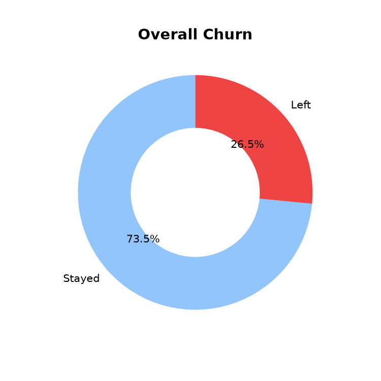
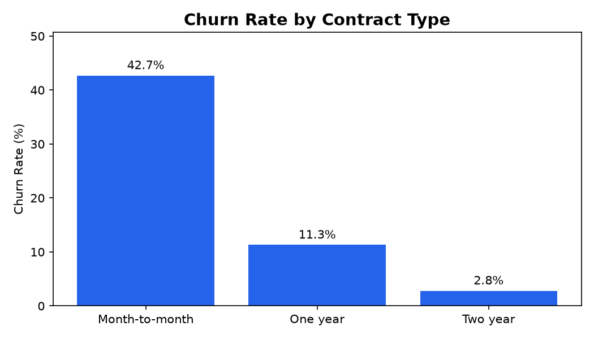
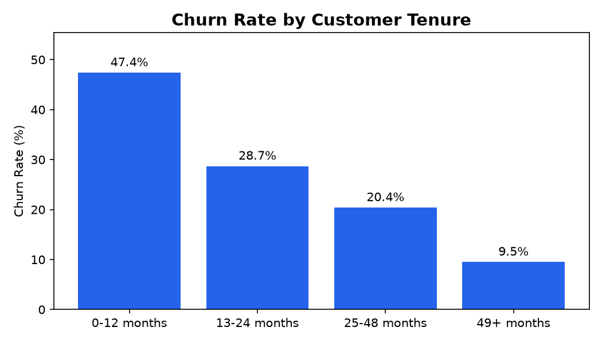
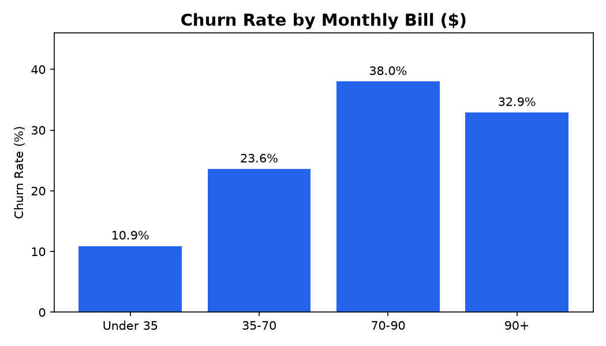

# Telco Customer Churn Analysis (SQL + Python)

Analysis of 7,043 telecom customers to find **who leaves, and why**, so the company can target retention efforts where they matter most.

## Business Questions
1. What percentage of customers leave?
2. Which contract types churn the most?
3. Do new customers leave more than long-term ones?
4. Do customers with higher monthly bills leave more?

## Tools Used
- **Python (pandas, matplotlib):** data cleaning and charts
- **SQL (SQLite):** aggregation and analysis queries
- **Jupyter Notebook:** analysis workflow
- **GitHub:** documentation

## Data
IBM Telco Customer Churn dataset: 7,043 customers, 21 columns (contract, tenure, services, charges, churn status).

## Data Cleaning
- Checked for blank values and duplicates (none found)
- `TotalCharges` was stored as text because 11 rows contained blank spaces. Converted it to numeric. All 11 customers had tenure 0 (brand-new customers with no bill yet), so their total was set to 0
- Created `ChurnFlag` (Yes = 1, No = 0) to calculate churn rates
- Converted `SeniorCitizen` from 0/1 to No/Yes for readable charts

## Key Findings
| Question | Result |
|---|---|
| Overall churn | **26.5%** of customers left (1,869 of 7,043) |
| Contract type | Month-to-month **42.7%**, One year **11.3%**, Two year **2.8%** |
| Tenure | First-year customers **47.4%**, versus **9.5%** for customers with 49+ months |
| Monthly bill | Highest churn in the $70 to $90 range (**38.0%**); lowest under $35 (**10.9%**). Churned customers paid more on average ($74.44 vs $61.27) |

**Additional segments**
- Month-to-month customers make up 55% of the base but **88.6% of all churners**
- New customers (12 months or less) on month-to-month contracts churn at **51.4%**
- Customers on longer contracts with more than 12 months of tenure churn at only **6.8%**

## Charts

## Recommendations
1. **Move month-to-month customers to longer contracts**, for example with a small discount for a one-year plan. This is the largest source of churn.
2. **Focus retention on the first 12 months.** More than half of all churners leave in their first year, so onboarding calls and early offers would have the biggest impact.
3. **Review the $70 to $90 plans.** Customers paying this much leave the most, so check whether the value matches the price.

## Files
- `churn_analysis.ipynb`: full analysis (cleaning, SQL queries, charts)
- `Telco_Clean.csv`: cleaned dataset
- `Telco-Customer-Churn.csv`: original dataset
- `chart1_overall.png` to `chart4_bill.png`: charts
